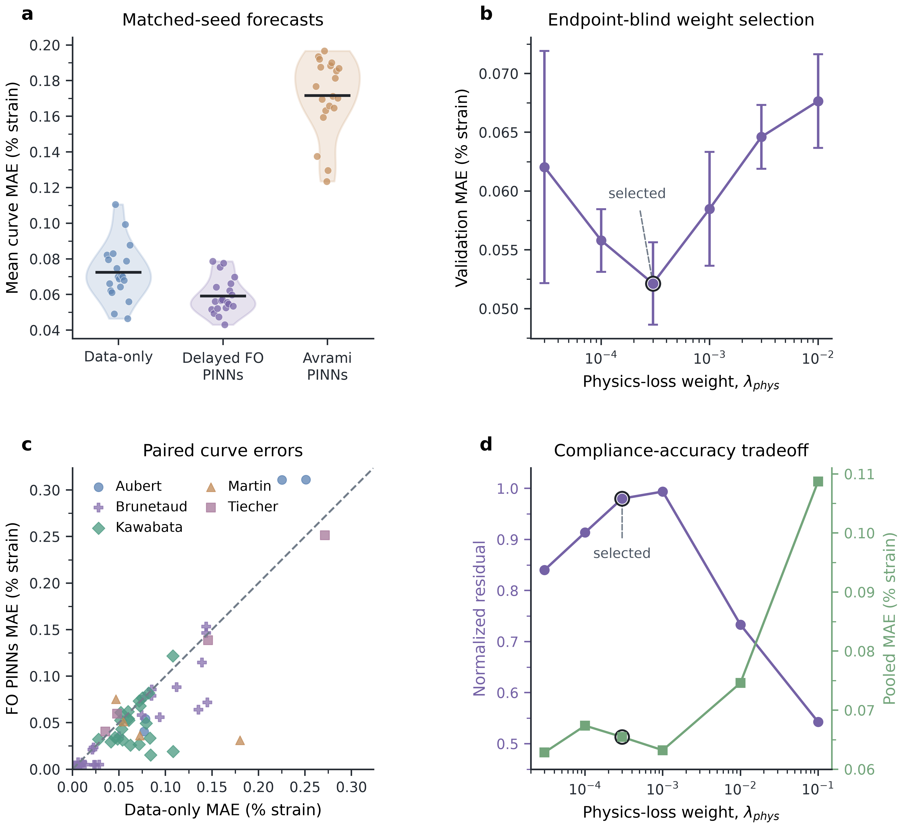

<h1><b>Physics-Informed Learning of Delayed Ettringite Formation Kinetics in Cementitious Materials</b></h1>

<p>Hossein Kabir and Nima Khodadadi*</p>

<p><sub>Department of Civil and Environmental Engineering, University of Illinois Urbana-Champaign, Urbana, IL, USA<br>
Department of Civil and Environmental Engineering, University of California, Berkeley, Berkeley, CA, USA<br>
<sup>*</sup>Corresponding author: nimakhan@berkeley.edu</sub></p>

## Overview

Delayed ettringite formation (DEF) can cause expansion in cementitious materials after heat treatment and subsequent moisture exposure. This study compares physics-informed neural networks (PINNs), data-only networks, direct kinetic fits, and simple extrapolation baselines for forecasting the unobserved final segment of an already measured expansion curve.

The dataset contains 61 curves and 1,725 measurements from five published studies. The primary models use training-only scaling and 20 matched optimization seeds. The analysis tests delayed first-order and Avrami residuals, compares optimizer variation with ensemble predictions, and evaluates source dependence, differential compliance, and sensitivity to training history and response scaling.

**Status:** reviewer revisions are in progress. This local folder has not been uploaded, and no repository DOI or publication acceptance is claimed. Saved historical audits refer to their recorded analysis, not blanket approval of the latest manuscript.

<p align="center">
  
</p>

**Figure.** Neural forecast comparison, internal weight selection, paired curve errors, and the tradeoff between differential compliance and pooled prediction error. Full captions and the qualifications on each estimand are in `docs/manuscript_source.md`.

## Repository Structure

```text
DEF-PINNs/
|-- asset/                  # Four manuscript figure previews
|-- src/                    # Extraction, model training, and analysis
|-- data/
|   |-- extracted/          # Coordinates, calibration, and extracted values
|   |-- modeling/           # Model-ready observations and fixed splits
|   |-- metadata/           # Bibliographic provenance
|   `-- screening/          # Relevance and screening decisions
|-- results/
|   |-- neural_models/      # Run settings, forecasts, and seed-level metrics
|   |-- direct_kinetic_fits/
|   |-- compiled/           # Archived primary inference
|   |-- c100_revision/      # Benchmark and source-level diagnostics
|   |-- reviewer_diagnostics/
|   `-- journal_check/      # Current review analyses and verification records
|-- docs/                   # Manuscript source and scientific code notes
|-- requirements.txt
|-- MANIFEST.json
`-- README.md
```

## Dataset

| Item | Value |
|---|---|
| Source studies | 5 |
| Expansion curves | 61 |
| Measurements | 1,725 |
| Primary training observations | 1,359 |
| Final held-out observations | 366 |
| Measurements per retained curve | 12-60 |
| Response unit | Expansion in % strain |
| Source composition | Brunetaud: 27; Kawabata: 22; Aubert, Tiecher, and Martin: 4 each |

The observation table is `data/modeling/def_kinetics_observations_v2.csv`. It includes source and curve identifiers, time, raw and modeled expansion, material descriptors, and fixed split membership. Bibliographic metadata identify the original studies. Raw negative values and modeling exclusions are documented rather than silently removed.

Publisher PDFs are not redistributed. Repeating extraction requires separately obtained lawful source PDFs in `data/source_pdfs/`, with the record-ID filenames used by the extraction scripts. Axis-calibration agreement and exact repeat extraction do not establish independent digitization accuracy. The removed ambiguous marker groups and the incomplete paper-level digitization audit remain limitations.

## Pipeline

1. **Literature and data assembly.** `collect_def_literature.py`, `extend_strict_def_corpus.py`, and `audit_def_relevance.py` preserve discovery, PDF validation, and screening logic. These network-dependent steps are separate from reproducing saved numerical results; configure your own contact information before any new collection. The `extract_*.py` files recover vector markers from source figures. `build_def_model_dataset.py` applies the documented calibration, branch, sampling, and split rules.
2. **Direct kinetics.** `fit_def_kinetic_candidates_v3.py` fits first-order, delayed first-order, delayed Avrami, Gompertz, and Larive relations with robust multistart optimization.
3. **Neural training.** `train_def_pinn_models_v3.py` trains data-only, shape-regularized, and kinetic-residual models. The primary run settings and seed lists are saved with the results. New runs save completed-seed outputs and model checkpoints.
4. **Evaluation and checks.** `compile_v3_results.py` reconstructs the archived inference. `analyze_current_review.py` adds the matched-optimizer ablation, 14-test Holm family, raw residual components, head-bound diagnostics, and exploratory mixed-effects sensitivity. `independent_submission_checks.py` checks equations and the archived prediction-level statistics.

## Results

| Comparison | Seed-averaged mean curve MAE (% strain) |
|---|---:|
| Delayed first-order PINNs | 0.0592 |
| Separately tuned data-only network | 0.0724 |
| Matched-optimizer shape/initial-state baseline, no kinetic residual | 0.0774 |

These arithmetic-mean differences do not establish a source-wide physics benefit. There are only five source studies, the exact source-sign test against data-only learning gives p=0.4375, and normalized differential residuals remain close to one. Persistence is more accurate on most curves. Independent Avrami weight selection prefers zero penalty.

**Sensitivity to scaling matters.** With per-curve training-maximum scaling, the five-seed mean curve MAE is 0.0554% for PINNs and 0.0498% for data-only learning. This changes loss weighting and dimensional head support. The result must not be described as a normalization-invariant advantage.

See `results/journal_check/review_inference_14_tests.csv`, `review_new_sensitivity_metrics.csv`, and `review_all_comparator_truncation.csv` for current review calculations. Some older files retain legacy names to preserve traceability; they are not additional published claims.

## Requirements

- Python 3.12
- PyTorch, NumPy, pandas, SciPy
- Matplotlib, SymPy, statsmodels
- PDF extraction dependencies listed in `requirements.txt`

```bash
python -m venv .venv
python -m pip install -r requirements.txt
```

Activate the virtual environment before installation. CPU-specific PyTorch wheels may require the official PyTorch wheel index. Exact package versions from the reference run are recorded in the archived run summaries. Results can vary with software and hardware. The temporary Word/PDF renderer is not part of the numerical pipeline.

## Usage

Run commands from the repository root:

```bash
python src/independent_submission_checks.py equations
python src/independent_submission_checks.py metrics
python src/analyze_current_review.py
python src/complete_review_comparators.py
python src/make_c100_figures.py
```

The metrics command verifies the archived 12-test inference; the review analysis adds and records the 14-test family separately. Some analysis commands overwrite their derived summaries. The comparator completion command repeats Larive fits at the shorter histories and can take several minutes.

To train a separate first-order run without replacing the reference forecasts:

```bash
python src/train_def_pinn_models_v3.py --models pinn_shifted_first_order --run-name reproduction_dfo --physics-weight 0.0003 --learning-rate 0.002 --weight-decay 1e-6 --epochs 1200
```

For the separately tuned data-only arm, use `--models data_only --learning-rate 0.004 --weight-decay 1e-5`. For the fixed-optimizer zero-residual ablation, use `--models shape_regularized --physics-weight 0` and otherwise retain the first-order configuration. Compare all reported seed lists and preprocessing settings before treating a new run as a reproduction.

## Citation

The manuscript is not yet published. Use its title and authors when referring to this working study; do not assign a journal year, article number, or DOI that has not been issued. Original experimental sources remain attributable to their authors through the supplied metadata.

## Contact

Hossein Kabir: hkabir2@illinois.edu<br>
Nima Khodadadi (corresponding author): nimakhan@berkeley.edu
